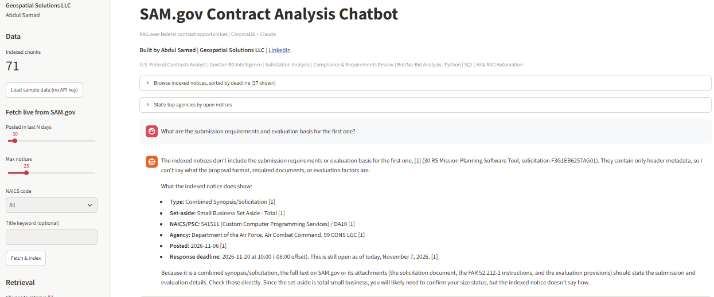
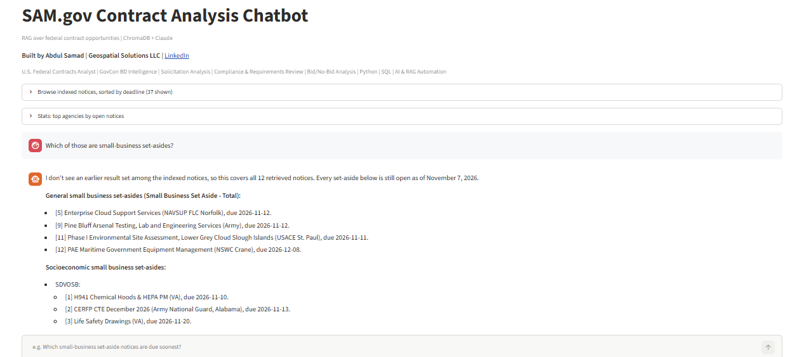
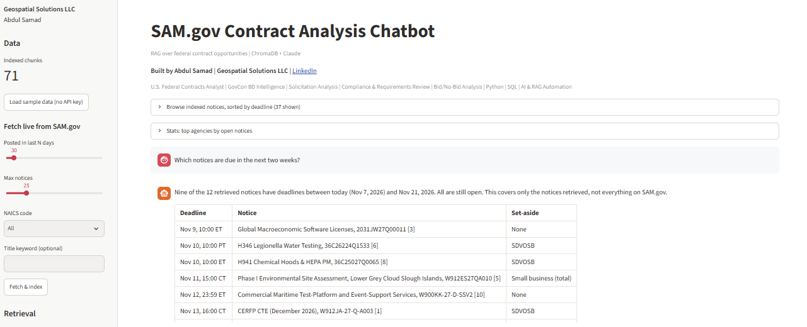
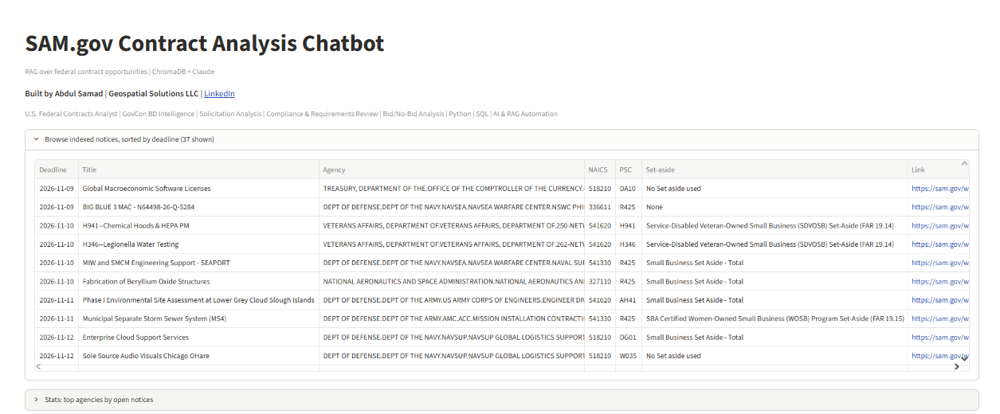
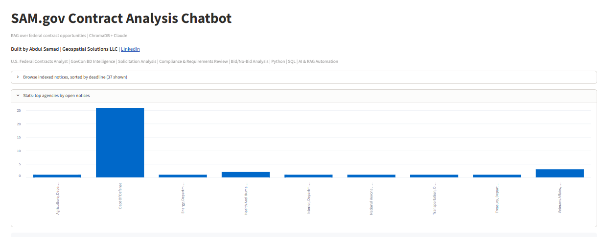
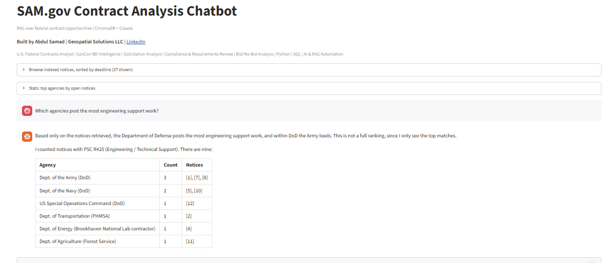

# SAM.gov Contract Analysis Chatbot (RAG)

A retrieval-augmented chatbot that answers questions about US federal contract opportunities from [SAM.gov](https://sam.gov), with source citations. Built as a portfolio project.

**Tech stack:** Python, Streamlit, ChromaDB, Claude API, SAM.gov Opportunities API

## Screenshots








## How it works

```
SAM.gov Opportunities API --> clean + chunk --> ChromaDB (local embeddings)
                                                      |
 user question --> semantic search (top-k, optional NAICS filter)
                                                      |
                     Claude answers using ONLY retrieved notices, with [n] citations
```

| File | Role |
|---|---|
| `sam_client.py` | Fetches/normalizes notices from the SAM.gov API |
| `rag.py` | Chunking, indexing, retrieval, Claude generation |
| `ingest.py` | CLI to load data (`--targets` pulls every code in `naics.py`) |
| `naics.py` | Target NAICS codes (424120, 325620) and code-to-title lookup |
| `app.py` | Streamlit chat UI with source citations |
| `sample_data/` | Synthetic notices so the demo works without a SAM key |

## Quickstart

**Windows (PowerShell)**

```powershell
python -m venv .venv
.venv\Scripts\Activate.ps1
pip install -r requirements.txt
copy .env.example .env        # then add ANTHROPIC_API_KEY (and SAM_API_KEY for live data)

python ingest.py --sample     # or: python ingest.py --targets --days 14 --limit 25
streamlit run app.py
```

**macOS / Linux**

```bash
python -m venv .venv && source .venv/bin/activate
pip install -r requirements.txt
cp .env.example .env          # then add ANTHROPIC_API_KEY (and SAM_API_KEY for live data)

python ingest.py --sample     # or: python ingest.py --targets --days 14 --limit 25
streamlit run app.py
```

First run downloads a small local embedding model (~80 MB).

## Example questions
- What office supply opportunities are open, and which are small-business set-asides?
- Which personal care product contracts require FDA documentation?
- Which opportunities require a security clearance?
- Compare the IT help desk and cloud migration notices by contract type and period.
- What small-business set-asides are due before December 1?
- Summarize the evaluation criteria for the CISA notice.

## Notes
- Get a free SAM.gov API key from your SAM.gov account profile. Non-federal keys have tight daily rate limits, so use `--no-desc` or small `--limit` values while testing (check the SAM.gov API docs for current limits).
- The search endpoint requires a posted-date range of up to one year; this project defaults to recent days.
- Sample data is synthetic. Verify anything important on SAM.gov; this is not legal or bid advice.

## Ideas to extend
- Hybrid search (BM25 + vectors) and a reranker
- Pull awards from USAspending.gov to add incumbent/pricing context
- Structured extraction (clearances, contract type, NAICS) into filterable metadata
- Evaluation set of Q&A pairs to measure retrieval hit rate and answer faithfulness
- Deploy on Streamlit Community Cloud or Hugging Face Spaces

## Built by
[samadas363](https://github.com/samadas363)